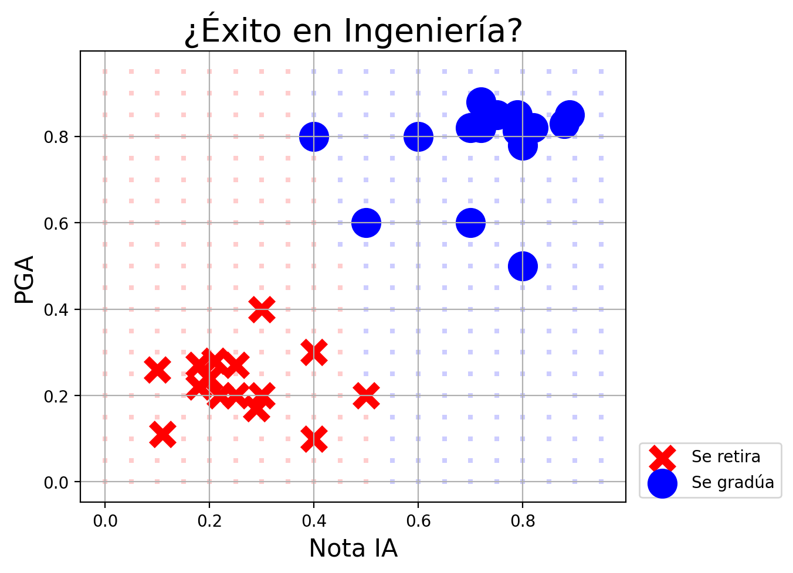
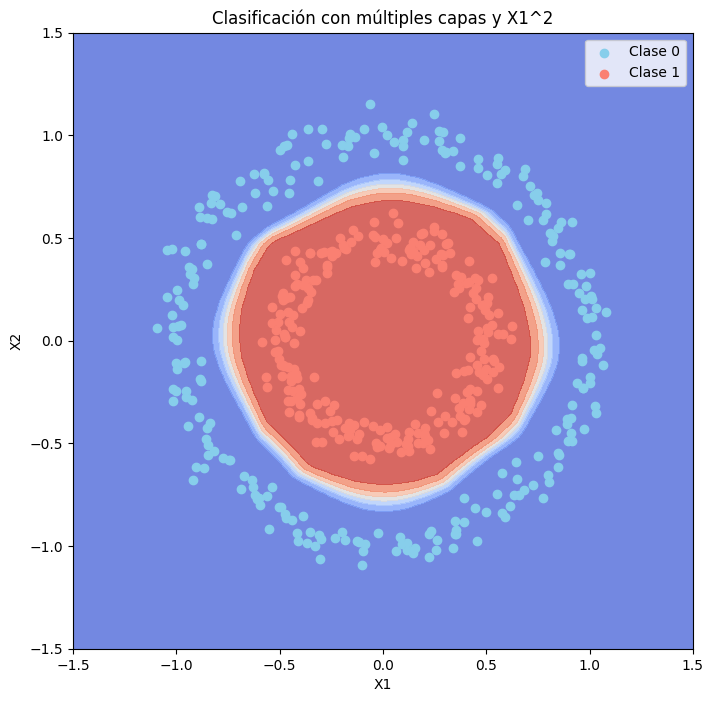
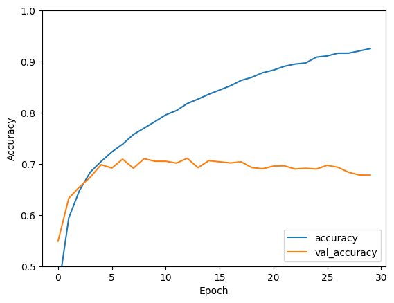
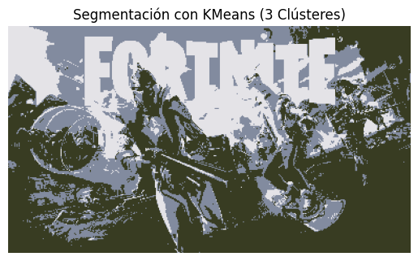
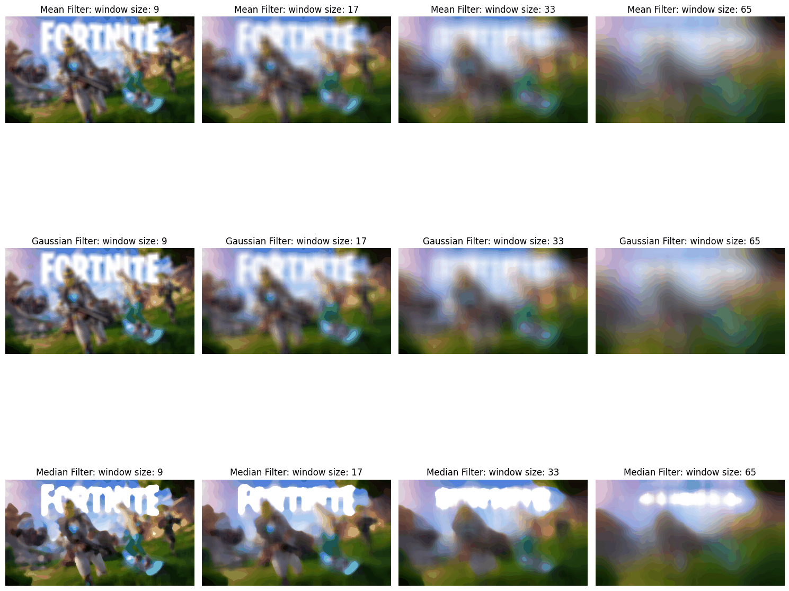
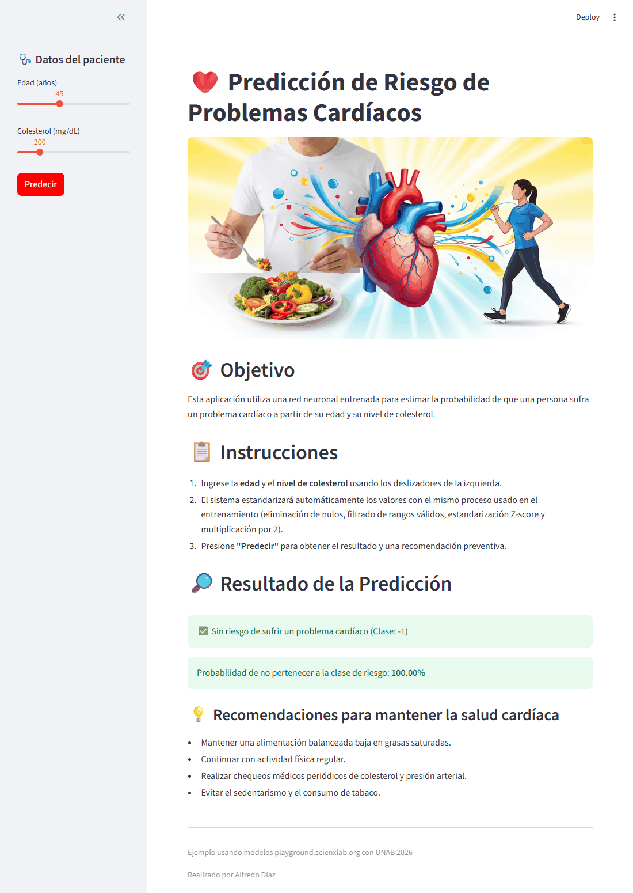

# Apuntes de Ciencia de Datos


Repositorio de apuntes, cuadernos y talleres del curso de **Ciencia de Datos** de la Universidad Autónoma de Bucaramanga (UNAB). Reúne el material trabajado en clase sobre redes neuronales artificiales: el perceptrón, las redes densas, el procesamiento de imágenes y las redes convolucionales, el aprendizaje por transferencia, la detección de objetos con YOLO, los autoencoders y las redes generativas adversarias (GAN). Incluye además un libro de estudio y una guía por carpeta con la teoría y los resultados de cada cuaderno.

**Autor:** Daniel Enrique Villamizar Ramírez  
**Docente:** Alfredo Antonio Díaz Claro

---

## Contenido

- [Estructura del repositorio](#estructura-del-repositorio)
- [Ruta de estudio](#ruta-de-estudio)
- [Vista previa](#vista-previa)
- [Libro de apuntes](#libro-de-apuntes)
- [Cómo ejecutar el material](#cómo-ejecutar-el-material)
- [Tecnologías](#tecnologías)
- [Fuentes y créditos](#fuentes-y-créditos)

---

## Estructura del repositorio

```text
ciencia_de_datos_apuntes/
├── apuntes/                      Libro de estudio (Markdown y Word)
├── Perceptron/                   Cuadernos 1, 1.1 y 2 + MLP con scikit-learn
├── Redes densas/                 Cuadernos 3, 4 y 5
│   └── Reconocimiento de prendas/    Fashion-MNIST: cuaderno, modelo y app
├── procesamiento de imagenes/    Cuadernos 6, 7, 8, 8 A2 y 9 (imágenes y CNN)
├── deteccion de objetos/        Cuadernos 9 a 9D (YOLOv8, YOLO11, OCR y puntos clave)
├── despliegue yolo11 streamlit/  6 modelos YOLO11 (detección, segmentación, pose) + app
├── Autoencoders Gans/            Cuadernos 14, 15A–15D y 19 (autoencoders, ECG y GAN)
├── taller/                       Taller: del dato a una app en Streamlit
└── imagenes/                     Figuras de las guías
    └── cuadernos/                Resultados extraídos de los cuadernos
```

## Ruta de estudio

| # | Tema | Material | Qué se aprende |
|---|------|----------|----------------|
| 1 | El perceptrón | [Cuaderno 1](Perceptron/Avanzada_Cuaderno_1_ANN_El_Perceptron.ipynb) · [Guía](Perceptron/Readme.md) | Neurona artificial, pesos, sesgo, función escalón, regla de actualización y entrenamiento manual con NumPy |
| 1.1 | Perceptrón con scikit-learn | [Cuaderno 1.1](<Perceptron/Cuanderno_1_1_Perceptron_con_Sklearn_ipynb (1).ipynb>) | `Perceptron` de scikit-learn, escalado con `MinMaxScaler`, accuracy y recall |
| — | Perceptrón multicapa | [MLP círculos concéntricos](<Perceptron/MLP Circuitos concentricos.ipynb>) | `MLPClassifier` sobre datos que no son linealmente separables |
| 2 | Frameworks | [Cuaderno 2](Perceptron/Avanzada_Cuaderno_2_ANN_Red_Neuronal_sklearn_keras_tensorflow.ipynb) | Tensores, sigmoide y softmax, diferenciación automática, compilación y entrenamiento en TensorFlow y Keras |
| 3 | Redes secuenciales | [Cuaderno 3](<Redes densas/Avanzada_Cuaderno_3_ANN_Red_neuronal_básica_de_regresion_lineal_Ejemplo.ipynb>) · [Guía](<Redes densas/Readme.md>) | Tres formas de declarar un modelo, `compile` → `fit` → `evaluate`, `input_shape`, regresión Celsius → Fahrenheit |
| 4 | Redes densas | [Cuaderno 4](<Redes densas/Avanzada_Cuaderno_4_ANN_Red_Neuronal_Clasificación_(Redes_densas).ipynb>) | Funciones de activación y de pérdida, tamaño de lote, sobreajuste, `EarlyStopping`, clasificación con `make_circles` |
| 5 | Regresión aplicada | [Cuaderno 5](<Redes densas/Cuaderno_Avanzado_5_Regresion_Aplicacion_Gasolina.ipynb>) | Predicción del consumo de gasolina con el conjunto Auto-MPG |
| — | Clasificación multiclase | [Reconocimiento de prendas](<Redes densas/Reconocimiento de prendas>) | Fashion-MNIST con `Flatten` + `Dense` + softmax y una app para dibujar y predecir |
| 6 | Procesamiento de imágenes | [Cuaderno 6](<procesamiento de imagenes/Avanzada Cuaderno 6  CNN  Procesamiento digital de imágenes.ipynb>) | Imágenes como arreglos, canales de color, convolución y kernels, filtros, Sobel, segmentación y contornos |
| 7 | Redes convolucionales | [Cuaderno 7](<procesamiento de imagenes/Avanzada_Cuaderno_7_CNN_Redes_Neuronales_Convolucionales_.ipynb>) | CNN desde cero sobre CIFAR-10: capas `Conv2D`, pooling, aumento de datos, evaluación y predicción |
| 8 | Transferencia de aprendizaje | [Cuaderno 8](<procesamiento de imagenes/Avanzada Cuaderno 8 CNN Transferencia de aprendizaje.ipynb>) | Modelos preentrenados (VGG16), extracción de características, congelar y descongelar capas, *fine-tuning* |
| 8 A2 | CNN para dígitos | [Cuaderno 8 A2](<procesamiento de imagenes/Avanzada_Cuaderno_8_A2_CNN_neuronales_convolucionales_Números_Modo_2_(Uso_de_RNC).ipynb>) | CNN sobre MNIST: entrenamiento con `EarlyStopping`, guardado de arquitectura y pesos, predicción de un dígito descargado |
| 9 | Convolución paso a paso | [Cuaderno 9](<procesamiento de imagenes/Avanzada_Cuaderno_9_Convolucion.ipynb>) · [Guía](<procesamiento de imagenes/Readme.md>) | Filtros Sobel 3 × 3 y *max pooling* 2 × 2 implementados con NumPy y SciPy sobre una foto |
| 9 | Clasificación de imágenes (taller) | [Taller de flores](<procesamiento de imagenes/Avanzada_Cuaderno_9_CNN_Taller_aplicado_Clasificación_de_imagenes_con_Tensorflow_y_Keras.ipynb>) | `image_dataset_from_directory`, sobreajuste, aumento de datos, `Dropout` y conversión a TensorFlow Lite |
| 9.1 | Detección de objetos | [Cuaderno 9](<deteccion de objetos/Avanzada_Cuaderno_9_CNN_Detección_de_Objetos_con_YOLOv8_y_Transfer_LearningL_.ipynb>) · [Guía](<deteccion de objetos/Readme.md>) | Modelos y formatos de detección, YOLOv8 desde cero vs. transferencia, predicción en video, exportación a ONNX y TFLite |
| 9A | Lectura de matrículas | [Cuaderno 9A](<deteccion de objetos/Avanzada_Cuaderno_9A_CNN_matriculas_de_vehiculos.ipynb>) | Detección de placas con YOLOv8 y lectura del texto con EasyOCR |
| 9B | Elementos de protección personal | [Cuaderno 9B](<deteccion de objetos/Avanzada_Cuaderno_9B_PPE_CNN_Entrenar_Detección_de_objeto_yolov8_Transfer_L.ipynb>) | Entrenamiento de YOLOv8 con un `data.yaml` propio y métricas en TensorBoard |
| 9C | Segmentación de instancias | [Cuaderno 9C](<deteccion de objetos/Avanzada_Cuaderno_9C_train_yolo11_instance_segmentation.ipynb>) | Anotación con polígonos en Roboflow y entrenamiento de YOLO11-seg con *early stopping* |
| 9D | Puntos clave | [Cuaderno 9D](<deteccion de objetos/Avanzada_Cuaderno_9D_Deteccion_puntos_clave2.ipynb>) | Regresión de puntos del cuerpo de perros con MobileNetV2 y aumento de datos |
| — | Visión por computador con YOLO11 | [despliegue yolo11 streamlit/](<despliegue yolo11 streamlit>) | Entrenamiento de 6 modelos YOLO11 (n y s) para daños en carros y despliegue en Streamlit |
| 14 | Autoencoders | [Cuaderno 14](<Autoencoders Gans/Avanzada_Cuaderno_14_Introducción_a_los_Autoencoder.ipynb>) · [Guía](<Autoencoders Gans/Readme.md>) | Encoder, espacio latente y decoder; reconstrucción y eliminación de ruido en Fashion-MNIST |
| 15A | Señales ECG | [Cuaderno 15A](<Autoencoders Gans/Avanzada_Cuaderno_15A_ECG_Introducción_procesamiento.ipynb>) | Lectura de registros de PhysioNet con `wfdb`, intervalos RR y frecuencia cardíaca |
| 15B | Anomalías cardiacas | [Cuaderno 15B](<Autoencoders Gans/Avanzada_Cuaderno_15B_ECG_Autoencoder.ipynb>) | Autoencoder entrenado con latidos normales y umbral sobre el error de reconstrucción (ECG5000) |
| 15C | Anomalías en un registro real | [Cuaderno 15C](<Autoencoders Gans/Avanzada_Cuaderno_15C_ECG_Autoencoder_LTAFDB_es.ipynb>) | Segmentación de latidos y detección de anomalías sobre la LTAFDB |
| 15D | Limpieza de imágenes | [Cuaderno 15D](<Autoencoders Gans/Avanzada_Cuaderno_15D_Limpieza_imagenes_2_autoencoders.ipynb>) | Autoencoder convolucional que limpia documentos escaneados con ruido |
| 19 | Redes generativas adversarias | [Cuaderno 19](<Autoencoders Gans/Avanzada_Cuaderno_19__GAN_keras.ipynb>) | Generador y discriminador en Keras que aprenden a crear dígitos de MNIST |
| — | Taller integrador | [taller/](taller) | Limpieza y estandarización de datos, exportación a JSON y despliegue de una red en Streamlit |

## Vista previa

| Perceptrón (cuaderno 1) | Redes densas (cuaderno 4) | CNN en CIFAR-10 (cuaderno 7) |
|:---:|:---:|:---:|
|  |  |  |
| **Segmentación K-Means (cuaderno 6)** | **Filtros (cuaderno 6)** | **Taller en Streamlit** |
|  |  |  |

Cada guía (`Readme.md` de cada carpeta) muestra los resultados de sus cuadernos con más detalle.

## Libro de apuntes

La carpeta [`apuntes/`](apuntes) contiene el resumen teórico de los cuadernos 1 a 8 y del taller, pensado para repasar antes del primer parcial:

| Archivo | Descripción |
|---------|-------------|
| [Resumen_Parcial_Ciencia_de_Datos.md](apuntes/Resumen_Parcial_Ciencia_de_Datos.md) | Versión para leer en GitHub: mapa temático, explicación de cada cuaderno y preguntas de repaso con respuesta corta |
| [Resumen_Cuadernos_Ciencia_de_Datos.docx](apuntes/Resumen_Cuadernos_Ciencia_de_Datos.docx) | Versión en Word, con índice, lista para imprimir |

Los temas posteriores (detección de objetos, autoencoders y GAN) se explican en la guía `Readme.md` de su carpeta, al igual que el resto de bloques.

## Cómo ejecutar el material

### Cuadernos

Los cuadernos están preparados para **Google Colab**: basta con abrirlos desde GitHub o subirlos a Colab y ejecutar las celdas en orden. Para trabajar en local:

```bash
git clone https://github.com/Daniverd15/ciencia_de_datos_apuntes.git
cd ciencia_de_datos_apuntes
python -m venv .venv
.venv\Scripts\activate        # En Linux/macOS: source .venv/bin/activate
pip install jupyter numpy pandas matplotlib seaborn scikit-learn scipy tensorflow opencv-python scikit-image pillow kagglehub
jupyter notebook
```

> - Requiere **Python 3.10 – 3.13** (TensorFlow 2.20 no está disponible para Python 3.14).
> - Los cuadernos descargan sus propios datos (con `curl`, `wget`, Keras o `kagglehub`), así que necesitan internet.
> - Algunas celdas de los cuadernos 6, 7 y 8 apuntan a rutas de Colab (`/content/...`); en local cámbialas por el nombre del archivo (por ejemplo, `/content/logo.jpg` → `logo.jpg`).
> - Para los cuadernos que entrenan redes convolucionales (7, 8, 9 y 9A–9D), conviene Colab con GPU (*Entorno de ejecución → Cambiar tipo de entorno → GPU T4*).
> - Los cuadernos de `deteccion de objetos/` instalan `ultralytics`, `roboflow` y `easyocr` en sus primeras celdas, y los que descargan de Roboflow piden una API key personal (gratuita). Los de ECG instalan `wfdb`.

### Aplicaciones en Streamlit

Taller de predicción de riesgo cardíaco:

```bash
cd taller
pip install -r requirements.txt
streamlit run app.py
```

Reconocimiento de prendas (Fashion-MNIST):

```bash
cd "Redes densas/Reconocimiento de prendas"
pip install -r requirements.txt
streamlit run app.py
```

Detección de daños en carros con YOLO11 (instala PyTorch y Ultralytics, ~1 GB):

```bash
cd "despliegue yolo11 streamlit"
pip install -r requirements.txt
streamlit run app.py
```

> Instala cada app en su propio entorno virtual (`python -m venv .venv`) para que sus dependencias no choquen. Todas se abren en **http://localhost:8501**.

## Tecnologías

| Área | Herramientas |
|------|--------------|
| Lenguaje y entorno | Python, Jupyter Notebook, Google Colab |
| Datos y visualización | NumPy, pandas, Matplotlib, Seaborn |
| Aprendizaje automático | scikit-learn |
| Aprendizaje profundo | TensorFlow, Keras |
| Imágenes | OpenCV, Pillow, scikit-image |
| Visión por computador | Ultralytics YOLOv8 y YOLO11, PyTorch, Roboflow, EasyOCR, Supervision |
| Señales biomédicas | wfdb (PhysioNet) |
| Exportación de modelos | Keras (`.keras`, `.h5`), TensorFlow Lite, ONNX |
| Despliegue | Streamlit, joblib |

## Fuentes y créditos

- Los cuadernos numerados (1 a 19) y las guías de `Perceptron/` y `Redes densas/` son material del curso, elaborado por el profesor Alfredo Antonio Díaz Claro: [adiacla/Apuntes-Ciencia-de-Datos](https://github.com/adiacla/Apuntes-Ciencia-de-Datos).
- Los cuadernos 6 a 19 y sus archivos de apoyo corresponden a los compartidos en clase.
- Para contrastar los apuntes también se consultó el repositorio de un compañero del curso: [AndiLinUnab/ciencia-de-datos-apuntes](https://github.com/AndiLinUnab/ciencia-de-datos-apuntes).
- Los conjuntos de datos pertenecen a sus respectivos autores: Auto-MPG (UCI Machine Learning Repository), Fashion-MNIST (Zalando Research), CIFAR-10 (Universidad de Toronto), Cats vs. Dogs filtrado y Flower Photos (Google/TensorFlow), MNIST, `cicatriz/danocarro` (CC BY 4.0), PPE Detection y los datasets de matrículas (Roboflow Universe), StanfordExtra (Stanford Dogs), Long Term AF Database (PhysioNet), ECG5000 (UCR Time Series Archive) y *noisy documents* (repositorio del docente).

Este repositorio tiene fines exclusivamente académicos.
