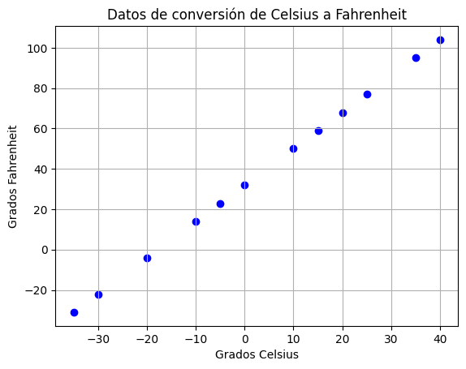
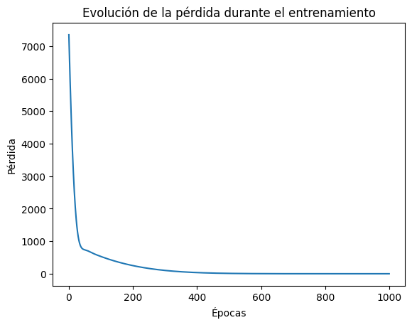
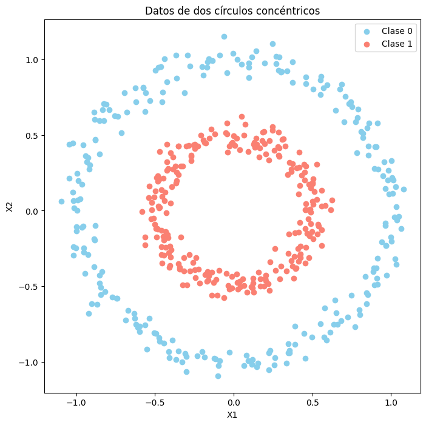
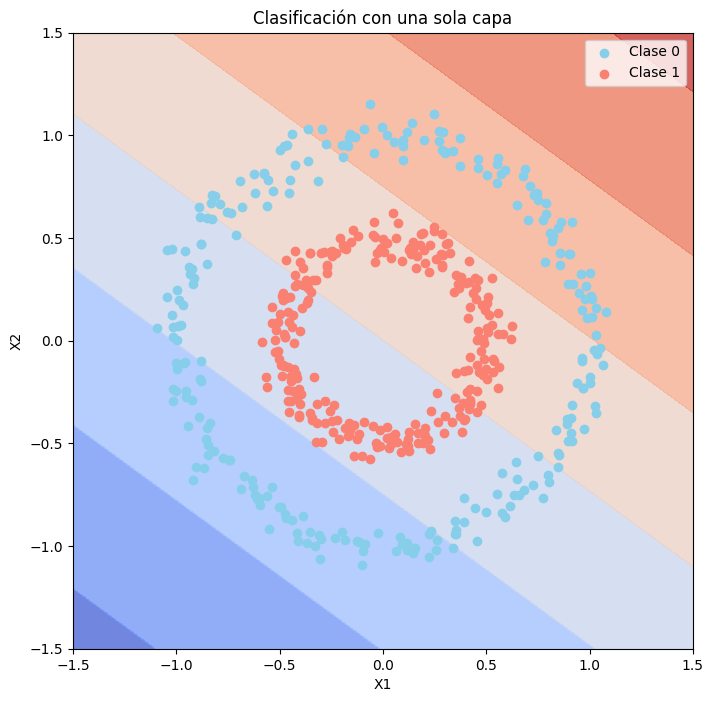
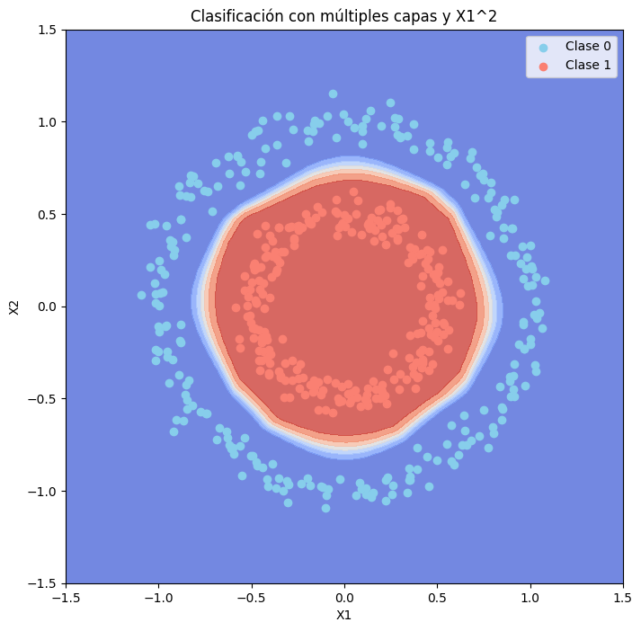
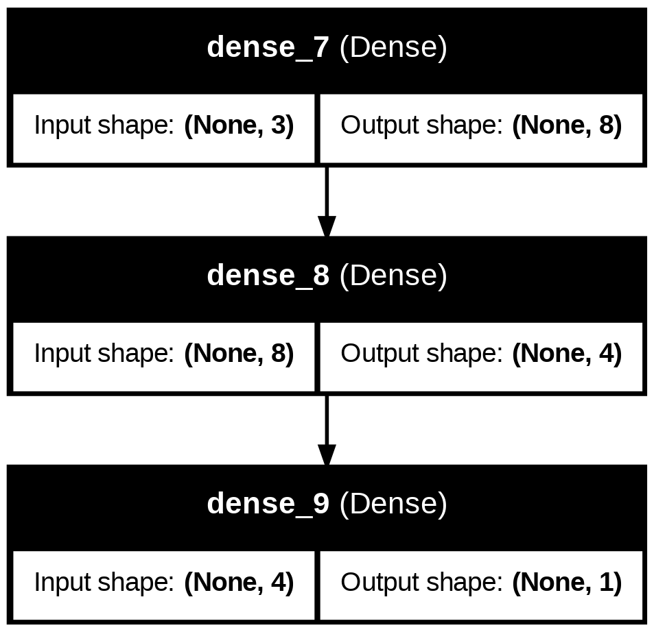
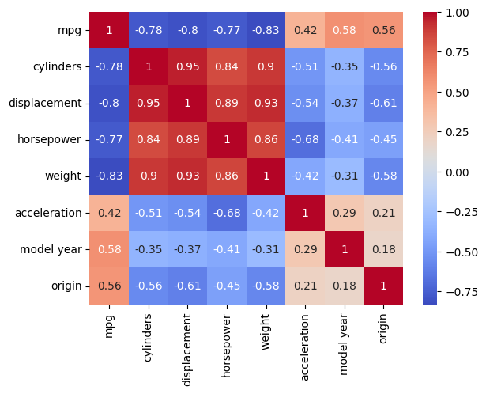

#  Guía de Estudio: Modelos Secuenciales en TensorFlow y Keras

¡Bienvenido a este repositorio! Este material ha sido diseñado como una **guía interactiva de estudio práctico y teórico**. Aquí aprenderás los fundamentos esenciales sobre la construcción, entrenamiento e inspección de redes neuronales utilizando **TensorFlow** y **Keras**.

>  **IMPORTANTE:** Los conceptos, estructuras de código y ejercicios explicados en este cuaderno forman parte de los **temas evaluados en el próximo examen. Utiliza este repositorio como tu material principal de repaso.

---

##  ¿Qué vas a aprender?

**1. Fundamentos Teóricos de Keras**
* **Construcción de Arquitecturas:** Aprenderás las 3 formas estándar de definir modelos en Keras (lista en `Sequential`, método incremental `.add()`, y la **API Funcional**).
* **Entorno de Trabajo:** Inspección del sistema (Python `3.12.12`), verificación de librerías y comprobación de soporte para GPU mediante `!nvidia-smi`].

**2. Práctica Aplicada (Paso a Paso)**
* **Regresión Lineal Simple:** Definición y entrenamiento de un perceptrón (una sola neurona).
* **Ejercicio Celsius a Fahrenheit:** Implementación de un modelo que aprende de forma autónoma la conversión matemática $Fahrenheit = (Celsius \times 1.8) + 32$
* **Estructura de Datos:** Creación de tensores/arreglos NumPy, preparación de características/etiquetas y separación de datos de entrenamiento (80%) y validación (20%)[

---
#  2 Redes Neuronales Densas (MLP) - Clasificación de Círculos Concéntricos

Este repositorio contiene un cuaderno de Jupyter Notebook (`Cuaderno 4. Redes densas.ipynb`) desarrollado por **Alfredo Diaz**. El proyecto combina fundamentos teóricos sobre arquitecturas de redes neuronales profundas con una práctica guiada para resolver un problema de clasificación no linealmente separable utilizando **TensorFlow / Keras** y **scikit-learn**.

-
El cuaderno se divide en dos bloques principales: **Fundamentos Teóricos** y **Práctica Guiada**.

### Fundamentos Teóricos

#### 🔹 Funciones de Activación
Explicación detallada, fórmulas matemáticas, rangos y usos recomendados para:
* **ReLU (Rectified Linear Unit)**: Opción por defecto para capas ocultas.
* **Sigmoid**: Ideal para capas de salida en clasificación binaria.
* **Tanh (Tangente Hiperbólica)**: Recomendada para capas ocultas con datos centrados en cero.
* **Linear (Identidad)**: Uso exclusivo en la capa de salida para problemas de regresión (*por defecto en Keras*).
* **Softmax**: Salida para clasificación multiclase exclusiva.

#### 🔹 Funciones de Pérdida (Loss Functions) y Métricas
* **Regresión**: Mean Squared Error (MSE), Mean Absolute Error (MAE).
* **Clasificación Binaria**: Binary Crossentropy ($\text{Sigmoid} + \text{Binary Crossentropy}$).
* **Clasificación Multiclase**: Categorical Crossentropy (One-hot) y Sparse Categorical Crossentropy (Enteros).
* **Diferencia clave**: La función de pérdida guía el aprendizaje (diferenciable); la métrica evalúa el rendimiento general.

#### 🔹 Arquitectura y Entrenamiento
* **Tamaño de Batch**: Concepto de Mini-batch Gradient Descent y tamaños recomendados (16, 32, 64, 128).
* **Diseño de Capas Ocultas**: Recomendaciones sobre el número de neuronas y compresión progresiva de características.
* **Partición de Datos**: Estrategias de división para Train, Validation y Test.
* **Detección de Sobreajuste (Overfitting)**: Identificación de brechas entre `loss` y `val_loss`.
* **Early Stopping**: Uso de callbacks en Keras (`patience`, `min_delta`, `restore_best_weights`).

---

###  Práctica: Clasificación de Círculos Concéntricos

Un taller práctico de clasificación binaria no lineal utilizando el conjunto de datos sintético `make_circles` de `scikit-learn`.
##  Puntos Clave para el Examen

Asegúrate de dominar los siguientes elementos presentes en el código:

* **Comparativa de APIs:** Identificar sintácticamente `model_a`, `model_b` y `model_c`
* **Flujo de Entrenamiento:** Uso correcto de los métodos `.compile()`, `.fit()` y evaluación de métricas.
* **Dimensiones de Entrada:** Manejo de la forma de los datos (`input_shape`) tanto para problemas sintéticos multivariables `(1000, 20)` como unidimensionales `(12,)

---

##  ¿Qué encontrarás en el repositorio?

Al abrirlos cuaderno sde Jupyter (`.ipynb`), serás guiado a través celdas organizadas lógicamente

Teoría y Practica 

inspección de resultados

---

##  Requisitos Rápidos

Para ejecutar y experimentar con el código localmente con VsC o en Google Colab:
* **Python 3.12+**
* Librerías: `tensorflow`, `numpy`, `matplotlib`

¡Abre el cuaderno, ejecuta las celdas en orden, analiza cada sección y prepárate para el quiz!

---

## Cuadernos de esta carpeta y resultados

| Cuaderno | Tema |
|---|---|
| [Cuaderno 3](<Avanzada_Cuaderno_3_ANN_Red_neuronal_básica_de_regresion_lineal_Ejemplo.ipynb>) | Tres formas de declarar un modelo en Keras y una neurona que aprende a convertir Celsius → Fahrenheit |
| [Cuaderno 4](<Avanzada_Cuaderno_4_ANN_Red_Neuronal_Clasificación_(Redes_densas).ipynb>) | Funciones de activación y de pérdida, y clasificación de círculos concéntricos con redes densas |
| [Cuaderno 5](Cuaderno_Avanzado_5_Regresion_Aplicacion_Gasolina.ipynb) | Regresión del consumo de gasolina (millas por galón) con el conjunto Auto-MPG |
| [Reconocimiento de prendas](<Reconocimiento de prendas>) | Fashion-MNIST con una red densa y una app de Streamlit |

**Cuaderno 3 — Celsius a Fahrenheit**

| Datos de entrenamiento | La pérdida baja durante 1000 épocas |
|:---:|:---:|
|  |  |

**Cuaderno 4 — una capa contra varias capas**

| Datos | Una sola capa (frontera lineal) | Varias capas (frontera circular) |
|:---:|:---:|:---:|
|  |  |  |

Con una sola capa la red solo puede trazar una recta y no separa los círculos; al añadir capas ocultas con ReLU aprende una frontera cerrada. La arquitectura final del cuaderno:

<p align="center"></p>

**Cuaderno 5 — correlación entre variables de Auto-MPG**

<p align="center"></p>

El consumo (`mpg`) tiene una correlación fuerte y negativa con el peso, la cilindrada, los caballos de fuerza y los cilindros: los carros más pesados y potentes recorren menos millas por galón.

## Cómo ejecutarlos

Ábrelos en Google Colab y ejecuta las celdas en orden. El cuaderno 5 descarga Auto-MPG desde Kaggle con `kagglehub` (`uciml/autompg-dataset`); funciona sin iniciar sesión. En local:

```bash
pip install jupyter numpy pandas matplotlib seaborn scikit-learn tensorflow kagglehub
jupyter notebook
```
