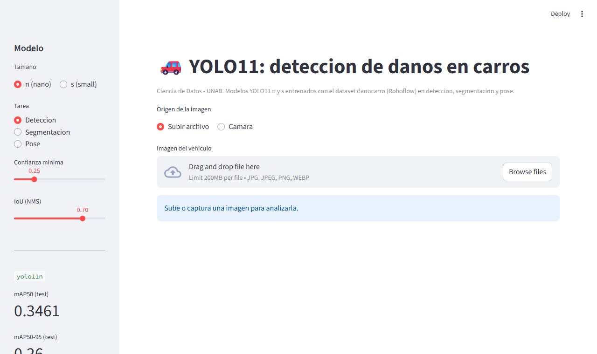
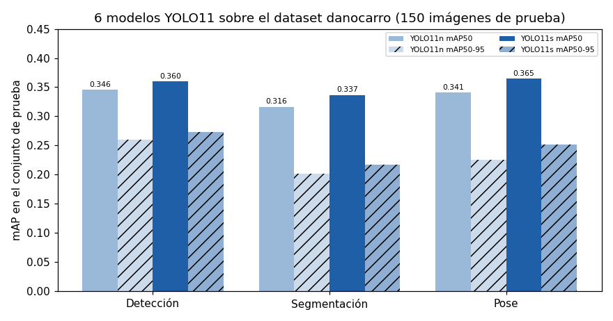

# Despliegue en Streamlit de YOLO11 (n | s) × (detección | seg | pose)

Actividad de Ciencia de Datos (UNAB), basada en el cuaderno *Avanzada Cuaderno 9C – train_yolo11_instance_segmentation*. Se entrenaron **6 modelos** YOLO11 para encontrar daños en carros y se publicaron en una app de Streamlit donde se elige el modelo, se sube una foto (o se toma con la cámara) y se ve el resultado anotado.

<p align="center"></p>

## Dataset

[`cicatriz/danocarro` v1](https://universe.roboflow.com/cicatriz/danocarro) (Roboflow Universe, CC BY 4.0): **3024** imágenes de entrenamiento, **318** de validación y **150** de prueba, anotadas con polígonos (segmentación) en 8 clases:

`Abolladura` · `Agrietado` · `Corrosión` · `Descascaramiento` · `Desportillado de pintura` · `Parte faltante` · `Parte rota` · `Rayón`

## Modelos (`modelos/`)

| Modelo | Tarea | mAP50 (test) | mAP50-95 (test) | Métrica |
|---|---|---|---|---|
| `yolo11n.pt` | Detección | 0.346 | 0.260 | caja |
| `yolo11s.pt` | Detección | 0.360 | 0.273 | caja |
| `yolo11n-seg.pt` | Segmentación | 0.316 | 0.202 | máscara |
| `yolo11s-seg.pt` | Segmentación | 0.337 | 0.217 | máscara |
| `yolo11n-pose.pt` | Pose | 0.341 | 0.225 | puntos clave |
| `yolo11s-pose.pt` | Pose | 0.365 | 0.252 | puntos clave |

<p align="center"></p>

Todas las métricas (precisión, recall, mAP) están en [`metricas.json`](metricas.json). El tamaño `s` supera al `n` en las tres tareas. Los valores son modestos (mAP50 ≈ 0.35) porque los daños son objetos pequeños, de bordes difusos y con clases que se parecen entre sí (rayón vs. desportillado, abolladura vs. parte rota); la **precisión** es aceptable (0.59–0.79) pero el **recall** es bajo (0.28–0.34): el modelo acierta en lo que marca, pero se le escapan muchos daños.

## Archivos

| Archivo | Para qué |
|---|---|
| `app.py` | App de Streamlit |
| `preparar_datasets.py` | Deriva los datasets de detección y pose a partir del de segmentación |
| `entrenar_todos.py` | Entrena los 6 modelos, copia cada `best.pt` a `modelos/` y guarda `metricas.json` |
| `modelos/` | Los 6 modelos entrenados (listos para usar) |
| `metricas.json` | Métricas sobre el conjunto de prueba |
| `requirements.txt` | Dependencias de la app |

## 1. Ejecutar la app (los modelos ya vienen entrenados)

Requiere Python 3.10 – 3.13.

```bash
cd "despliegue yolo11 streamlit"
python -m venv .venv
.venv\Scripts\activate          # Windows  (Linux/macOS: source .venv/bin/activate)

# PyTorch para CPU primero (evita descargar ~2.5 GB de CUDA); con GPU NVIDIA sáltate esta línea
pip install torch torchvision --index-url https://download.pytorch.org/whl/cpu
pip install -r requirements.txt

streamlit run app.py
```

Se abre en **http://localhost:8501**. En la barra lateral eliges:

- **Tamaño:** `n` (nano, más rápido) o `s` (small, más preciso).
- **Tarea:** detección (cajas), segmentación (máscaras) o pose (5 puntos clave por daño).
- **Confianza mínima** e **IoU** de la supresión de no máximos.

Luego subes una foto del vehículo o la tomas con la cámara. La app muestra la imagen original junto a la anotada y una tabla con clase, confianza, caja y área de la máscara.

> Usa fotos de carros **con daños visibles**: con un carro en buen estado el modelo puede marcar algún falso positivo con confianza baja (< 0.3), que se filtra subiendo la *confianza mínima*.

## 2. Reentrenar los 6 modelos

Hace falta una **GPU NVIDIA** (el script usa `device=0`); se entrenó en una RTX 5070 con PyTorch cu128. Sin GPU local, el mismo procedimiento funciona en Google Colab con GPU T4.

**a) Instalar PyTorch con CUDA y Ultralytics**

```bash
pip install torch torchvision --index-url https://download.pytorch.org/whl/cu128
pip install "ultralytics>=8.3" roboflow
```

**b) Descargar el dataset** con tu propia API key de Roboflow (gratuita, en *Roboflow → Settings → API Keys*), guardada como variable de entorno y **nunca** en el código:

```bash
# Windows (PowerShell):  $env:ROBOFLOW_API_KEY="tu_clave"
export ROBOFLOW_API_KEY=tu_clave
python -c "import os; from roboflow import Roboflow; Roboflow(api_key=os.environ['ROBOFLOW_API_KEY']).workspace('cicatriz').project('danocarro').version(1).download('yolov11', location='trabajo/dataset_seg')"
```

La carpeta **debe** llamarse `dataset_seg` dentro de la carpeta de trabajo, porque `entrenar_todos.py` busca ahí el dataset de segmentación.

**c) Generar los datasets de detección y pose**

```bash
python preparar_datasets.py trabajo/dataset_seg trabajo
```

Crea `trabajo/dataset_detect` (la caja que encierra cada polígono) y `trabajo/dataset_pose` (caja + 5 puntos clave **derivados del contorno**: superior, inferior, izquierdo, derecho y centro). El dataset no trae puntos clave anotados a mano, así que la pose es una adaptación didáctica.

**d) Entrenar y evaluar**

```bash
python entrenar_todos.py trabajo 30
```

Para cada combinación hace *transfer learning* desde los pesos de COCO, con `imgsz=640`, `batch=16`, máximo 30 épocas y *early stopping* (`patience=8`), y evalúa sobre el conjunto de **test**. Los `best.pt` quedan en `modelos/` y las métricas en `metricas.json`.

> El script se salta los modelos que ya están en `metricas.json`; para reentrenarlos todos, borra ese archivo (o sus entradas) antes de ejecutarlo.

## Créditos

Dataset `cicatriz/danocarro` (Roboflow Universe, CC BY 4.0) · Ultralytics YOLO11 · Cuaderno base del profesor Alfredo Antonio Díaz Claro.
