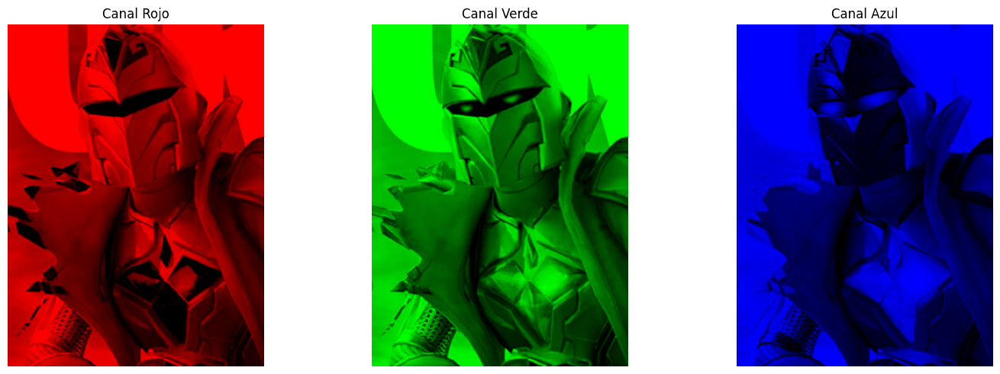
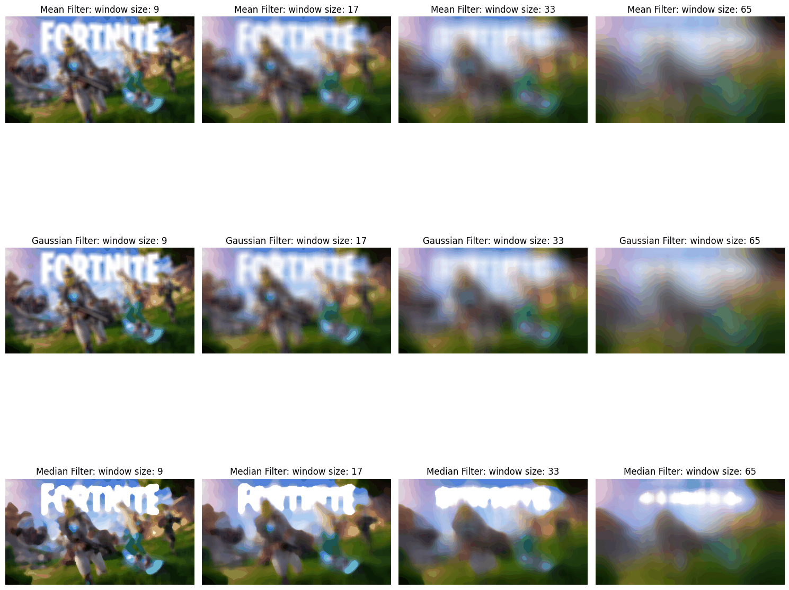
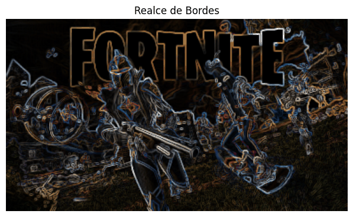
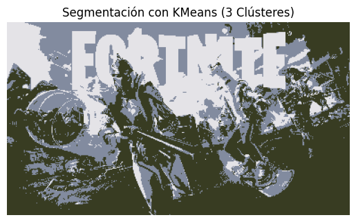
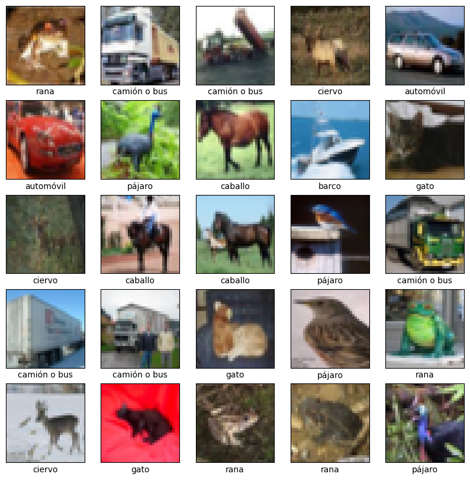
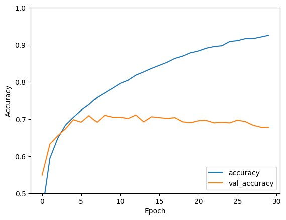
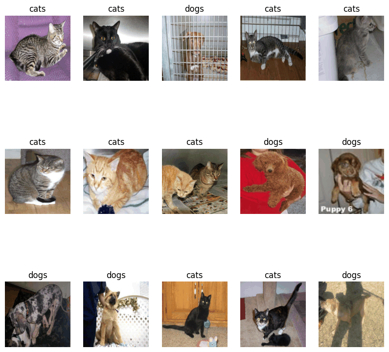
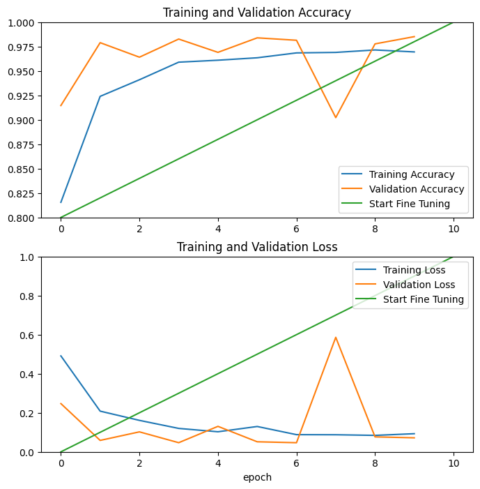

# Procesamiento de imágenes y redes convolucionales

Cuadernos 6 a 9 del curso: de la imagen como matriz de números hasta las redes convolucionales (CNN) y el aprendizaje por transferencia.

| Cuaderno | Tema | Datos que usa |
|----------|------|---------------|
| [Cuaderno 6](<Avanzada Cuaderno 6  CNN  Procesamiento digital de imágenes.ipynb>) | Procesamiento digital de imágenes: imágenes como arreglos, canales de color, convolución y kernels, filtros, detección de bordes, umbralización, segmentación y contornos | `logo.jpg`, `motinor.jpg` y la imagen de Fortnite: el cuaderno los descarga con `curl` y también están en esta carpeta |
| [Cuaderno 7](Avanzada_Cuaderno_7_CNN_Redes_Neuronales_Convolucionales_.ipynb) | CNN desde cero sobre CIFAR-10: capas `Conv2D` y de pooling, entrenamiento, evaluación y predicción sobre una foto de internet (un avión) | CIFAR-10 (`datasets.cifar10.load_data()`, ~170 MB) |
| [Cuaderno 8](<Avanzada Cuaderno 8 CNN Transferencia de aprendizaje.ipynb>) | Aprendizaje por transferencia con VGG16: clasificación con el modelo preentrenado, extracción de características, congelar capas y *fine-tuning* | `imagenesvgg16.zip` (perro, bus, vaso) y `cats_and_dogs_filtered.zip` de Google, ambos descargados por el cuaderno |
| [Cuaderno 8 A2](<Avanzada_Cuaderno_8_A2_CNN_neuronales_convolucionales_Números_Modo_2_(Uso_de_RNC).ipynb>) | CNN para reconocer dígitos escritos a mano: arquitectura, entrenamiento con `EarlyStopping`, guardado del modelo y de sus pesos, y predicción sobre una imagen descargada | MNIST (`datasets.mnist.load_data()`) y `numero9.jpg` |
| [Cuaderno 9](Avanzada_Cuaderno_9_Convolucion.ipynb) | Convolución Sobel 3 × 3 y *max pooling* 2 × 2 paso a paso con NumPy y SciPy | `gato.JPG` (se descarga con `curl` en el cuaderno) |
| [Cuaderno 9 · Taller aplicado](<Avanzada_Cuaderno_9_CNN_Taller_aplicado_Clasificación_de_imagenes_con_Tensorflow_y_Keras.ipynb>) | Clasificación de flores con `image_dataset_from_directory`, `Rescaling`, diagnóstico del sobreajuste, aumento de datos (`RandomFlip`, `RandomRotation`, `RandomZoom`), `Dropout` y conversión a TensorFlow Lite | `flower_photos.tgz` (5 clases, ~220 MB) |

La continuación de estos temas, con detección de objetos, segmentación y puntos clave, está en [`deteccion de objetos/`](<../deteccion de objetos>).

## Cómo ejecutarlos

**En Google Colab (recomendado, sobre todo para los cuadernos 7 y 8, que entrenan redes):**

1. Abre el cuaderno desde GitHub en Colab (*Archivo → Abrir cuaderno → GitHub* y pega la URL del repositorio).
2. Para el 7 y el 8 activa la GPU: *Entorno de ejecución → Cambiar tipo de entorno de ejecución → GPU T4*.
3. Ejecuta las celdas en orden: las imágenes y los datos se descargan solos en `/content/`.

**En local:**

```bash
pip install jupyter numpy pandas matplotlib scikit-learn scikit-image scipy opencv-python pillow tensorflow
cd "procesamiento de imagenes"
jupyter notebook
```

Algunas celdas apuntan a rutas de Colab (`/content/...`); en local cámbialas por el nombre del archivo, por ejemplo `/content/logo.jpg` → `logo.jpg`. Las celdas que empiezan con `!curl` o `!wget` necesitan esas herramientas instaladas (en Windows 10/11 `curl` ya viene incluido).

## Archivos de apoyo (cuaderno 6)

| Archivo | Para qué se usa |
|---|---|
| `logo.jpg` | Lectura con Matplotlib y OpenCV, canales, escala de grises y binarización |
| `motinor.jpg` | Lectura de una imagen con `mpimg.imread` |
| `fortnite-og-social-1920x1080-a5adda66fab9.jpg` | Canales RGB, filtros, bordes, umbralización y segmentación |
| `carita.csv` | Imagen pequeña guardada como matriz de números (material de apoyo de la clase) |
| `output_image.jpg` | **Salida** del cuaderno: la imagen que guarda `cv.imwrite` |
| `colour_rotation.gif` | **Salida** del cuaderno: animación de rotación de color (requiere ImageMagick en local) |

Los cuadernos 7, 8 y 9 descargan sus propios datos; no hay que preparar nada.

## Qué se obtiene

**Cuaderno 6 — procesamiento clásico de imágenes**

| Separación de canales RGB | Filtros de media, gaussiano y mediana |
|:---:|:---:|
|  |  |
| **Realce de bordes** | **Segmentación con K-Means (3 clústeres)** |
|  |  |

**Cuaderno 7 — CNN sobre CIFAR-10**

| Muestra del conjunto de datos | Exactitud de entrenamiento vs. validación |
|:---:|:---:|
|  |  |

La exactitud de entrenamiento sigue subiendo hasta ~0.93 mientras la de validación se queda en ~0.70 desde la época 8: es un caso claro de **sobreajuste**, que motiva el aumento de datos, el `Dropout` y el aprendizaje por transferencia del cuaderno 8.

**Cuaderno 8 — transferencia de aprendizaje con VGG16**

| Gatos y perros de entrada | Curvas antes y después del *fine-tuning* |
|:---:|:---:|
|  |  |
