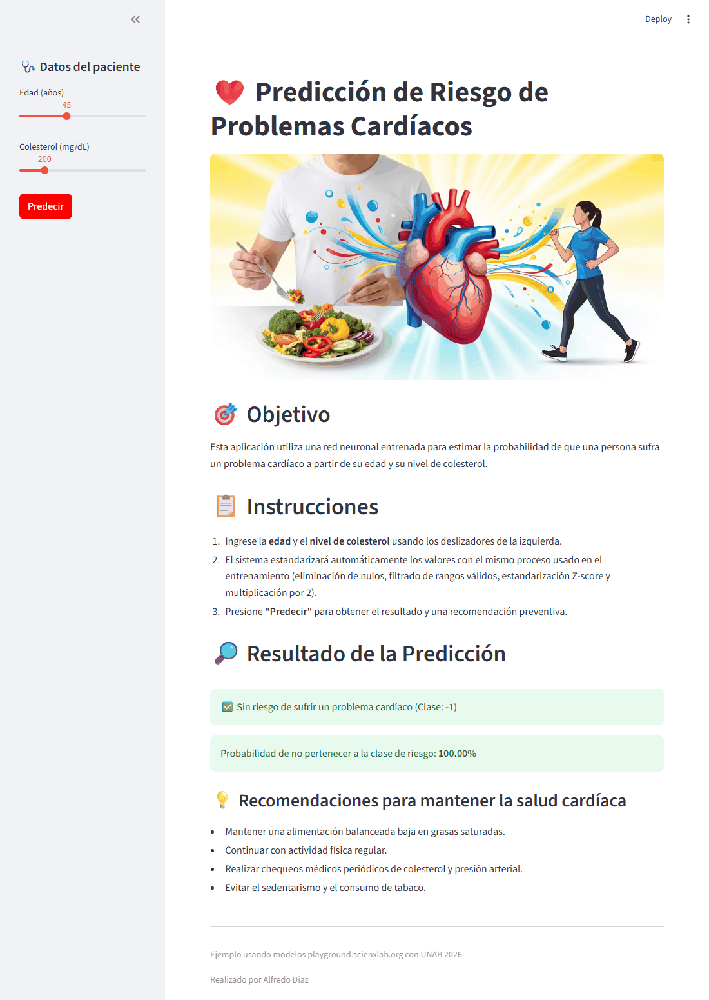
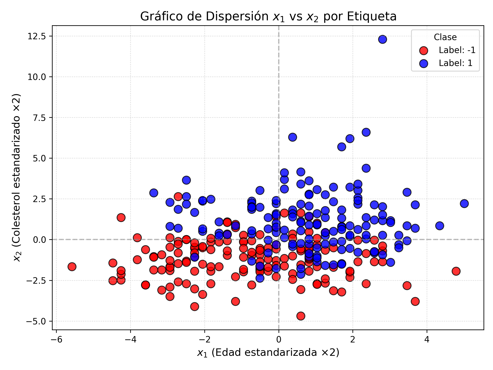

# Taller: del dato a la aplicación

Flujo completo de un problema de clasificación binaria: predecir el riesgo de problemas cardíacos a partir de la **edad** y el **colesterol** de un paciente. Los datos se limpian y estandarizan en Python, la red neuronal se entrena de forma visual en [ScienxLab Playground](https://playground.scienxlab.org) y sus pesos se copian a una app de Streamlit.

<p align="center"></p>

```text
pacientes.csv ──► procesamiento.py ──► datos_procesados.json ──► ScienxLab Playground ──► función forward ──► app.py
                        │                                          (entrenamiento visual)    (pesos de la red)      ▲
                        └──► modelo_estandarizacion.joblib ─────────────────────────────────────────────────────────┘
```

## Archivos

| Archivo | Descripción |
|---------|-------------|
| `pacientes.csv` | Datos originales: 302 pacientes con `edad`, `colesterol` y `problema_cardiaco` (0/1) |
| `procesamiento.py` | Limpia los datos, los estandariza y genera el resto de archivos |
| `datos_procesados.json` | Datos estandarizados en el formato `{"x", "y", "label"}` del *playground* |
| `modelo_estandarizacion.joblib` | `StandardScaler` ajustado, para transformar datos nuevos igual que en el entrenamiento |
| `grafico_dispersion.png` | Gráfico de dispersión de los datos procesados |
| `app.py` | App de Streamlit con la red escrita a mano (pesos tomados del *playground*) |
| `app2.py` | Variante que carga un modelo de scikit-learn desde `modelo.joblib` (no incluido) |
| `requirements.txt` | Dependencias |

## Paso a paso

### 1. Instalar

```bash
cd taller
python -m venv .venv
.venv\Scripts\activate          # Windows  (Linux/macOS: source .venv/bin/activate)
pip install -r requirements.txt
```

### 2. Preprocesar los datos

```bash
python procesamiento.py
```

`procesamiento.py` hace, en orden:

1. **Elimina nulos** (`dropna`) y filtra rangos válidos: edad 0–120 y colesterol 100–600.
2. **Recodifica la clase:** `0 → -1` y `1 → 1` (la salida de la red es `tanh`, en el rango −1 a 1).
3. **Estandariza** edad y colesterol con *Z-score* y multiplica por 2: `x = (valor − μ) / σ × 2`.
4. Guarda el escalador (`modelo_estandarizacion.joblib`), el JSON y el gráfico de dispersión:

<p align="center"></p>

### 3. Entrenar la red en el *playground*

1. Abre [playground.scienxlab.org](https://playground.scienxlab.org).
2. En **DATA → Upload your own JSON**, carga `datos_procesados.json`.
3. Configura *Problem type* = Classification, *Activation* = ReLU y capa de salida *Tanh*.
4. En **FEATURES** activa `X1`, `X2` y `X1X2` (el producto de ambas entradas).
5. Usa **4 capas ocultas de 8, 6, 4 y 3 neuronas**: es la arquitectura cuyos pesos están en `app.py` (neuronas `a1`–`a21`, salida `a22`).
6. Entrena con ▶ hasta que el *Test loss* se estabilice y exporta el código de la red (función `forward` en Python).

### 4. Pasar los pesos a la app

Reemplaza la función `forward(X1, X2)` al inicio de `app.py` por la exportada. La app aplica a la entrada el **mismo** escalador del paso 2 (`scaler.transform(...) * 2`) antes de llamar a `forward`, y clasifica como riesgo si la salida es ≥ 0.

### 5. Ejecutar la app

```bash
streamlit run app.py
```

En la barra lateral se eligen la edad y el colesterol y se pulsa **Predecir**. La app muestra la clase, una probabilidad aproximada (`(salida + 1) / 2`) y recomendaciones preventivas.

> `app2.py` necesita un `modelo.joblib` entrenado con scikit-learn en la misma carpeta; no se incluye en el repositorio, así que la app que funciona tal cual es `app.py`.
